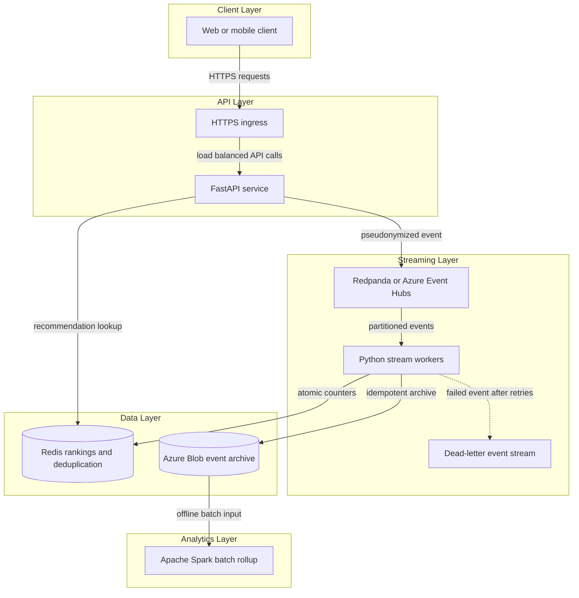

# Architecture Diagram

Streamify is a real-time interaction processing prototype. Its layers separate request intake, event processing, low-latency serving, and durable batch analytics.

## Application Architecture

<!-- mermaid-checked: no \n, no em-dash/en-dash, no {} in labels, subgraphs are id["label"], arrows are -->|"label"|, all subgraphs closed by end, ids unique -->

### Technology Stack Summary

| Layer | Technology | Version | Purpose |
|---|---|---|---|
| Client | HTTP JSON client | N/A | Submits interactions and requests recommendations |
| API | Python and FastAPI | Python 3.12, FastAPI 0.115+ | Validates events, pseudonymizes user IDs, publishes and serves results |
| Streaming | Confluent Kafka client and Redpanda | Kafka API, client 2.6+ | Local partitioned event broker |
| Streaming | Azure Event Hubs | Managed service | Cloud event broker with Kafka endpoint and OAuth bearer auth |
| Processing | Python worker | Python 3.12 | Consumes events, retries, archives, updates rankings |
| Serving | Redis | Redis 7.4 local | Sorted-set ranking cache and Lua-based deduplication |
| Storage | Azure Blob Storage SDK | 12.23+ | Durable cloud JSON event archive using managed identity |
| Analytics | Apache Spark | PySpark 4.x | Batch aggregation of archived interaction events |
| Orchestration | Docker Compose and Kubernetes/AKS | Compose v2, Kubernetes autoscaling/v2 | Local service wiring and cloud deployment |
| Observability | Prometheus client and Locust | Current compatible releases | Request metrics and repeatable performance tests |

### Data Storage & External Services

Redis stores expiring global and per-pseudonym user track rankings. Event records are written to local JSON files in Compose or deterministic JSON object paths in Azure Blob Storage in cloud. Redpanda provides the local Kafka API; Azure Event Hubs is configured as the managed cloud broker. Spark reads archived JSON and writes Parquet aggregates. Cloud storage uses Azure DefaultAzureCredential and Event Hubs uses OAuth bearer tokens from Azure Identity.

### Key Architectural Decisions

- The broker decouples request acceptance from eventual recommendation updates.
- At-least-once delivery is combined with deterministic archive keys and atomic Redis idempotency; no cross-service exactly-once transaction is claimed.
- User identifiers are HMAC-pseudonymized before entering the event stream; pseudonymized data remains potentially linkable and is not claimed to be anonymous.

## Component Relationships

```mermaid
flowchart LR
    subgraph PresentationLayer["Presentation"]
        cEventRoute["Event ingestion route"]
        cRecommendationRoute["Recommendation route"]
        cHealth["Health endpoints"]
    end
    subgraph BusinessLayer["Business Logic"]
        cValidator["Event schema validation"]
        cPseudonymizer["HMAC pseudonymizer"]
        cPublisher["Kafka publisher"]
        cStreamConsumer["Stream consumer"]
        cProcessor["Idempotent event processor"]
    end
    subgraph DataAccessLayer["Data Access"]
        cRedis["Redis ranking store"]
        cArchive["Blob or local archive"]
        cBroker["Kafka event stream"]
        cDlq["Dead-letter stream"]
    end
    subgraph CrossCuttingLayer["Cross Cutting"]
        cMetrics["Prometheus request metrics"]
        cConfig["Environment configuration"]
    end

    cEventRoute -->|"validates"| cValidator
    cValidator -->|"accepted event"| cPseudonymizer
    cPseudonymizer -->|"pseudonymized record"| cPublisher
    cPublisher -->|"publishes"| cBroker
    cBroker -->|"consumed by group"| cStreamConsumer
    cStreamConsumer -->|"processes"| cProcessor
    cProcessor -->|"archives idempotently"| cArchive
    cProcessor -->|"updates with deduplication"| cRedis
    cStreamConsumer -.->|"retry exhausted"| cDlq
    cRecommendationRoute -->|"reads ranked tracks"| cRedis
    cHealth -->|"checks dependencies"| cRedis
    cHealth -->|"checks broker"| cBroker
    cMetrics -.->|"observes requests"| cEventRoute
    cMetrics -.->|"observes requests"| cRecommendationRoute
    cConfig -.->|"configures services"| cPublisher
    cConfig -.->|"configures services"| cProcessor
```

<!-- mermaid-checked: no \n, no em-dash/en-dash, no {} in labels, subgraphs are id["label"], arrows are -->|"label"|, all subgraphs closed by end, ids unique -->

### Component Inventory

| Component | Layer | Type | Responsibility |
|---|---|---|---|
| Event ingestion route | Presentation | FastAPI endpoint | Validate request and return accepted event ID |
| Recommendation route | Presentation | FastAPI endpoint | Return popular tracks excluding tracks seen by the pseudonym |
| Health endpoints | Presentation | FastAPI endpoints | Report liveness and dependency readiness |
| Event schema validation | Business Logic | Pydantic model | Reject unexpected fields and unsafe identifiers |
| HMAC pseudonymizer | Business Logic | Security helper | Replace raw user identifier with keyed digest |
| Kafka publisher | Business Logic | Confluent producer adapter | Publish events and dead-letter records |
| Stream consumer | Business Logic | Confluent consumer | Consume partitions and commit offsets after processing |
| Idempotent event processor | Business Logic | Redis Lua and storage orchestration | Archive events and atomically update expiring rankings |
| Redis ranking store | Data Access | Redis sorted sets | Serve popular and per-user track rankings |
| Blob or local archive | Data Access | Storage adapter | Persist deterministic JSON event objects |
| Kafka event stream | Data Access | Redpanda or Event Hubs | Buffer and distribute interaction events |
| Dead-letter stream | Data Access | Kafka topic or Event Hub | Retain records that exceed bounded retries |
| Prometheus request metrics | Cross Cutting | Middleware and metrics endpoint | Expose request counts and latency histogram |
| Environment configuration | Cross Cutting | Pydantic settings | Load service endpoints, topics, secrets, and limits |
